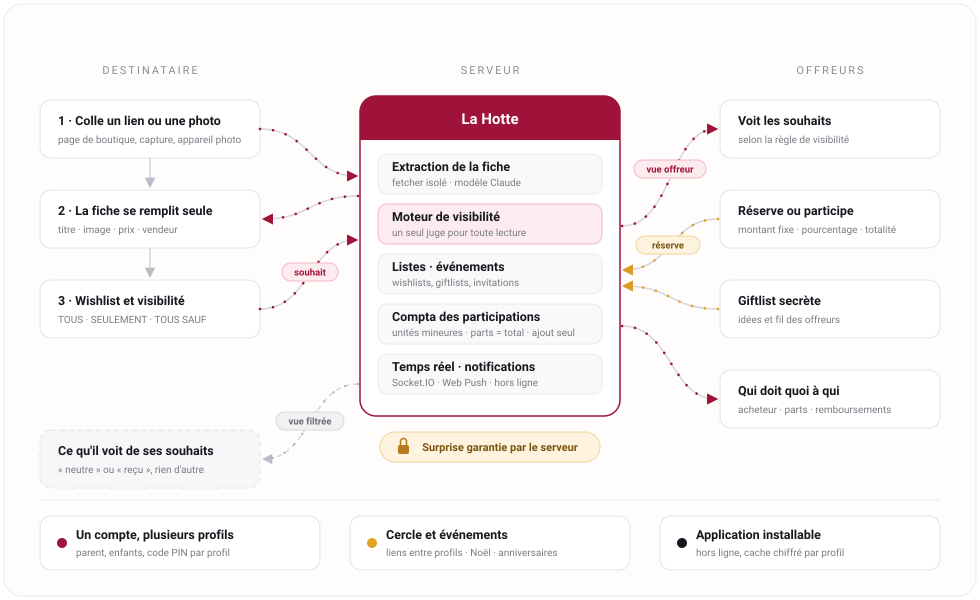
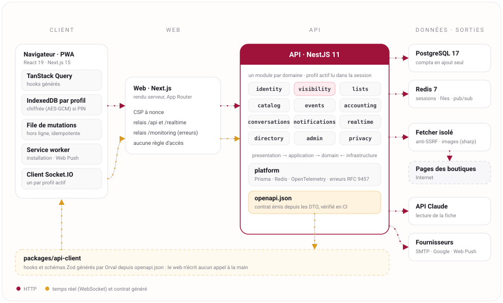
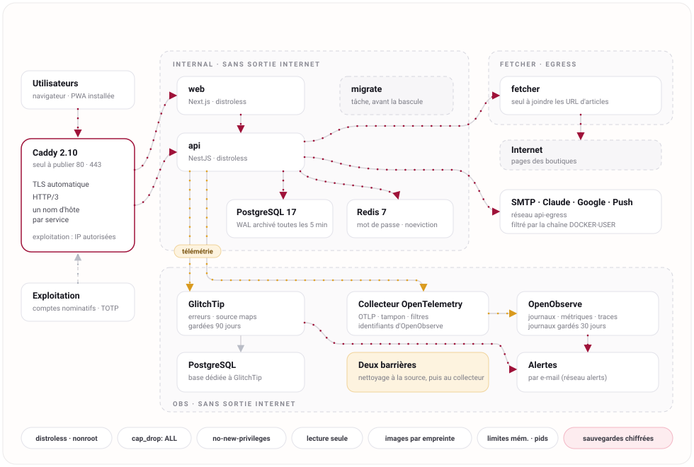

<h1 align="center">La Hotte</h1>

<p align="center">
  Dire ce qu'on aimerait recevoir, organiser ce qu'on offre et se répartir les frais,<br/>
  <strong>sans jamais gâcher une surprise.</strong>
</p>

<p align="center">
  <a href="https://github.com/servalD/La-Hotte/actions/workflows/ci.yml"></a>
  <a href="LICENSE"></a>
  <a href="docs/spec"></a>
  
  
  
  <br/>
  
  
  
  
  
  
  
</p>

La Hotte est une application web installable (PWA) de listes de souhaits et de cadeaux. Un compte regroupe plusieurs profils (toute la famille sur un même téléphone), une fiche article se remplit seule à partir d'un lien ou d'une photo, et chaque cadeau commun a un acheteur, des parts et un état de remboursement. Le tout en temps réel et hors ligne.

Trois promesses guident le produit :

1. **Ajouter un souhait prend dix secondes** : on colle un lien ou on prend une photo, la fiche se remplit seule.
2. **La surprise est garantie par construction** : la personne qui reçoit ne peut pas voir qui offre quoi, même par erreur.
3. **Personne n'avance de l'argent dans le flou** : chaque cadeau commun a un acheteur, des parts, et un état de remboursement.

---

## Comment ça marche



- **Le destinataire** colle un lien ou une photo ; le serveur récupère la page par un service isolé, lit ses données structurées et, à défaut, en fait tirer la fiche par un modèle Claude (titre, image, prix, vendeur), que l'utilisateur valide. Il range ses souhaits dans une wishlist et choisit qui les voit : `TOUS`, `SEULEMENT` certains profils, ou `TOUS SAUF`.
- **Les offreurs** voient les souhaits, les réservent ou y participent (montant fixe, pourcentage ou totalité), tiennent entre eux des giftlists secrètes et savent à tout moment qui doit quoi à qui.
- **Le serveur décide de tout ce qui est visible.** Un seul moteur juge chaque lecture, par tous les canaux (API, temps réel, notifications, recherche, export). Le destinataire ne voit de ses propres souhaits que « neutre » ou « reçu » : les données d'offreur ne lui sont jamais envoyées, pas même masquées.

Le vocabulaire (profil, cercle, élément, participation…) est défini dans le [glossaire](docs/spec/00-vision-glossaire.md).

## Architecture



- **Monorepo pnpm et Turborepo** ([ADR 0001](docs/adr/0001-monorepo.md)) : `apps/web` (Next.js, PWA), `apps/api` (NestJS), `apps/fetcher` (seul service qui joint une URL d'utilisateur), `packages/api-client` (généré), `packages/config`.
- **API en architecture propre**, un module par domaine ([ADR 0002](docs/adr/0002-clean-architecture.md)) ; le sens des imports est vérifié par une règle ESLint. Le module `visibility` est le seul juge de ce qu'un profil peut lire ([ADR 0004](docs/adr/0004-moteur-de-visibilite.md)).
- **Contrat généré** : les DTO produisent `openapi.json`, d'où Orval génère les hooks et schémas Zod du web ([ADR 0009](docs/adr/0009-contrat-api-openapi.md)). La CI échoue si le contrat n'est pas à jour.
- **Temps réel** par Socket.IO, un salon par profil, après validation de la transaction ([ADR 0006](docs/adr/0006-temps-reel.md)).
- **Hors ligne** : cache TanStack Query en IndexedDB, une base par profil, chiffrée pour un profil à PIN, et file de mutations idempotente ([ADR 0005](docs/adr/0005-offline.md)).

## Infrastructure et observabilité



- **Un VPS, Docker Compose** ([ADR 0008](docs/adr/0008-hebergement.md), [ADR 0021](docs/adr/0021-mise-en-oeuvre-phase-7.md)) : Caddy est le seul à publier des ports. Les réseaux `internal` et `obs` n'ont aucune sortie vers Internet ; seuls le fetcher (pages d'articles) et l'API (fournisseurs, filtrés par l'hôte) sortent.
- **Observabilité auto-hébergée** ([ADR 0012](docs/adr/0012-observabilite-auto-hebergee.md)) : les applications envoient journaux, métriques et traces en OTLP à un collecteur OpenTelemetry, qui les transmet à OpenObserve ; les erreurs vont à GlitchTip par les SDK Sentry. Aucun contenu (titre, commentaire, montant, URL d'article) ne sort : nettoyage à la source, puis seconde barrière au collecteur, vérifiées par des tests de non-fuite.
- **Durcissement** : images distroless sans shell ni gestionnaire de paquets, utilisateur non root, `cap_drop: ALL`, lecture seule, images désignées par empreinte, déploiement avec retour arrière automatique, sauvegardes chiffrées quotidiennes et journaux de transactions toutes les 5 minutes.

Exploitation détaillée : [`ops/production/README.md`](ops/production/README.md).

## Démarrer

Prérequis : **Node 22**, **pnpm 10** (`corepack enable`), **Docker**.

```sh
# 1. Variables locales (même FETCHER_TOKEN dans les deux fichiers)
cp apps/api/.env.example apps/api/.env
cp apps/fetcher/.env.example apps/fetcher/.env

# 2. PostgreSQL 17, Redis 7 et Mailpit
docker compose up -d

# 3. Dépendances, migrations, puis API (:4000) et web (:3000)
pnpm install
pnpm db:migrate:deploy
pnpm dev
```

Ouvrir <http://localhost:3000>. Les e-mails (vérification d'adresse, invitations) arrivent dans Mailpit : <http://localhost:8025>. L'extraction par modèle demande `ANTHROPIC_API_KEY` dans `apps/api/.env` ; sans elle, seules les données structurées des pages (JSON-LD, OpenGraph) remplissent la fiche.

Autres façons de lancer :

| Commande                                            | Effet                                                                 |
| --------------------------------------------------- | --------------------------------------------------------------------- |
| `docker compose --profile apps up -d --build`       | Tout dans Docker, depuis les images de production                     |
| `docker compose --profile apps --profile lan up -d` | Site ouvert au réseau local en HTTPS (`:8443`), pour tester un mobile |
| `docker compose --profile obs up -d`                | Ajoute GlitchTip (`:8000`), OpenObserve (`:5080`) et le collecteur    |

Vérifier avant de proposer un changement :

```sh
pnpm lint && pnpm typecheck && pnpm test
pnpm test:integration    # PostgreSQL et Redis réels
pnpm test:e2e            # Playwright bureau et mobile, avec axe (après pnpm build)
```

La liste complète des commandes, les invariants à ne jamais enfreindre et les conventions de commit sont dans [`CLAUDE.md`](CLAUDE.md) ; les règles propres à chaque application dans [`apps/api/CLAUDE.md`](apps/api/CLAUDE.md) et [`apps/web/CLAUDE.md`](apps/web/CLAUDE.md).

## Documentation

| Besoin                                     | Où                                                                                                      |
| ------------------------------------------ | ------------------------------------------------------------------------------------------------------- |
| Vision, personas, vocabulaire              | [`docs/spec/00-vision-glossaire.md`](docs/spec/00-vision-glossaire.md)                                  |
| Règles métier par domaine                  | [`docs/spec/01`](docs/spec) à `11` (comptes, articles, listes, visibilité, événements, compta…)         |
| Modèle de données, API, tests, déploiement | [`docs/spec/12`](docs/spec/12-modele-de-donnees.md) à [`14`](docs/spec/14-qualite-tests-deploiement.md) |
| Décisions d'architecture                   | [`docs/adr/`](docs/adr)                                                                                 |
| Avancement et phases                       | [`docs/roadmap.md`](docs/roadmap.md)                                                                    |
| Production                                 | [`ops/production/README.md`](ops/production/README.md)                                                  |

Les règles sont numérotées (`VIS-20`, `CPT-07`…) et citées dans le code, les tests et les messages de commit.

## Licence

[GNU AGPL v3](LICENSE).
