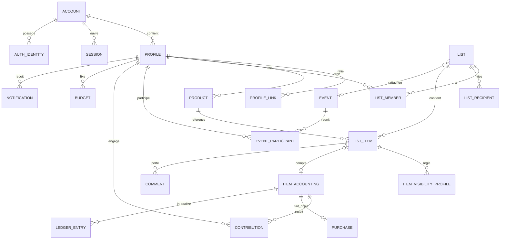

# 12 — Modèle de données

## Objectif

Décrire les entités, leurs relations et les contraintes garanties par la base. Le schéma Prisma en sera la traduction ; ce document reste la référence fonctionnelle.

## Conventions

- Clés primaires : UUID v7 (ordonnés dans le temps, non devinables).
- Toutes les tables : `created_at`, `updated_at` ; `version` (entier) sur les entités modifiables hors ligne ; `deleted_at` pour la corbeille.
- Montants : `amount_minor` (entier 64 bits) + `currency` (ISO 4217, 3 lettres).
- Dates et heures en UTC ; le fuseau du profil sert à l'affichage et aux heures calmes.
- Les énumérations de ce document sont des types énumérés en base.

## Vue d'ensemble

## Identité

| Table            | Champs principaux                                                                                                                                                                                                                                                                                                                                        | Contraintes                                                                                                                                                                                                                                                                                                                                                                                                                                                                                                                                                                                                                                                                                                                                                        |
| ---------------- | -------------------------------------------------------------------------------------------------------------------------------------------------------------------------------------------------------------------------------------------------------------------------------------------------------------------------------------------------------- | ------------------------------------------------------------------------------------------------------------------------------------------------------------------------------------------------------------------------------------------------------------------------------------------------------------------------------------------------------------------------------------------------------------------------------------------------------------------------------------------------------------------------------------------------------------------------------------------------------------------------------------------------------------------------------------------------------------------------------------------------------------------ |
| `account`        | `email`, `email_verified_at`, `password_hash?`, `role` (`USER`/`MODERATOR`/`ADMIN`), `status` (`ACTIVE`/`SUSPENDED`/`PENDING_DELETION`), `last_sign_in_at?` (RGPD-13), `publication_suspended_at?` (MOD-10), `deletion_requested_at?` (RGPD-12, présent si et seulement si `PENDING_DELETION`, `CHECK`), `totp_secret_enc?`, `totp_enabled_at?`, `totp_last_step?`, `age_attested_at?`, `guardian_account_id?`, `guardian_attested_at?`, `guardian_release_requested_at?`, `pending_invitation_id?`, `auth_epoch`                                                                                                               | `guardian_account_id` : compte tuteur d'un compte sous tutelle (PRO-15), `ON DELETE RESTRICT` ; `guardian_attested_at` : déclaration d'autorité parentale du tuteur (RGPD-06) ; `CHECK` : `age_attested_at` présent, ou `guardian_account_id` et `guardian_attested_at` présents ; rôle `USER` seul sous tutelle (`CHECK`) ; un compte tuteur n'a pas lui-même de tuteur, et tout profil d'un compte sous tutelle a `is_child` (déclencheurs) ; `guardian_release_requested_at` : levée demandée par le tuteur, effective à la déclaration d'âge (PRO-16) ; `pending_invitation_id` : invitation à consommer à la vérification de l'e-mail (AUTH-09, LNK-08), `SET NULL` si elle disparaît ; `email` unique, insensible à la casse ; `totp_secret_enc` chiffré (SEC-22), présent dès l'inscription au TOTP, `totp_enabled_at` posé à sa confirmation ; `totp_last_step` : dernier pas TOTP accepté (AUTH-11), seulement avec un TOTP actif ; `age_attested_at` : déclaration « 15 ans ou plus » (AUTH-08) ; `auth_epoch` : génération d'authentification, augmentée par tout événement qui révoque toutes les sessions (ADR 0013, double incrément de l'ADR 0014)                                                                                                                                                              |
| `auth_identity`  | `account_id`, `provider` (`GOOGLE`), `subject`                                                                                                                                                                                                                                                                                                           | (`provider`, `subject`) unique ; (`account_id`, `provider`) unique : une seule identité Google par compte (AUTH-03). Aucun jeton Google n'est conservé : seul l'identifiant `sub` sert                                                                                                                                                                                                                                                                                                                                                                                                                                                                                                                                                                             |
| `recovery_code`  | `account_id`, `code_hash`, `used_at?`                                                                                                                                                                                                                                                                                                                    | (`account_id`, `code_hash`) unique ; `code_hash` : SHA-256 du code normalisé (SEC-22) ; régénérer remplace tous les codes du compte, désactiver le TOTP les supprime (AUTH-10)                                                                                                                                                                                                                                                                                                                                                                                                                                                                                                                                                                                     |
| `account_token`  | `account_id`, `purpose` (`EMAIL_VERIFY`/`EMAIL_CHANGE`/`EMAIL_CHANGE_CANCEL`/`PASSWORD_RESET`/`PROFILE_EMAIL_VERIFY`/`TRANSFER_CONSENT`/`TRANSFER_CANCEL`), `token_hash`, `new_email?`, `profile_id?`, `transfer_id?`, `expires_at`, `used_at?`                                                                                                                                                                                                     | `PROFILE_EMAIL_VERIFY` porte `profile_id` et l'adresse dans `new_email` (PRO-10) ; `TRANSFER_CANCEL` porte `profile_id` et `transfer_id`, envoyé aussi à l'adresse précédente si l'actuelle a moins de 7 jours (PRO-12) ; `TRANSFER_CONSENT` porte `profile_id` et `transfer_id`, désarmé si l'adresse du profil change (PRO-10, PRO-12) ; un `PASSWORD_RESET` demandé par un tuteur (PRO-16) vise le compte sous tutelle mais part à l'adresse du tuteur ; `token_hash` unique (SHA-256, jeton de 256 bits) ; usage unique ; durées dans `01` (« Valeurs par défaut ») ; émettre un jeton invalide les jetons non utilisés du même compte et du même usage, sauf `EMAIL_CHANGE_CANCEL` (une nouvelle demande ne désarme pas un lien d'annulation déjà reçu) ; `new_email` : adresse à confirmer (`EMAIL_CHANGE`) ou adresse à rétablir (`EMAIL_CHANGE_CANCEL`) ; un changement d'e-mail confirmé invalide les jetons `EMAIL_VERIFY` et `EMAIL_CHANGE` encore ouverts ; une annulation invalide les jetons `EMAIL_VERIFY`, `EMAIL_CHANGE` et `PASSWORD_RESET` ouverts et les `EMAIL_CHANGE_CANCEL` émis après le sien, et efface `password_hash` ; un `EMAIL_CHANGE_CANCEL` ouvert réserve son `new_email` au compte (AUTH-16) |
| `session`        | `account_id`, `token_hash`, `auth_epoch`, `active_profile_id?`, `reauth_at?`, `trusted_device_id?`, `user_agent`, `last_seen_at`, `expires_at`, `absolute_expires_at`, `shared_device` (OFF-30)                                                                                                                                                         | `token_hash` unique (SHA-256 du jeton) ; `account_id` en `ON DELETE RESTRICT` : une session ne disparaît que par la procédure de révocation ; `auth_epoch` égal à celui du compte, sinon la session est refusée ; `id` seul identifiant exposé par l'API. Le déverrouillage du PIN n'est **pas** en base : il vit dans Redis seulement, et une session relue depuis la base a son profil actif verrouillé (ADR 0013). `last_seen_at` et `expires_at` recopiés depuis Redis au plus toutes les 5 minutes                                                                                                                                                                                                                                                            |
| `trusted_device` | `account_id`, `token_hash`, `user_agent`, `created_at`, `expires_at`, `revoked_at?`                                                                                                                                                                                                                                                                      | `token_hash` unique ; valable 30 jours (AUTH-12), révocable depuis l'espace Compte ; révoqué par une réinitialisation du mot de passe ou une désactivation du TOTP ; révoquer un appareil révoque les sessions qui le désignent                                                                                                                                                                                                                                                                                                                                                                                                                                                                                                                                    |
| `profile`        | `account_id`, `display_name`, `avatar`, `accent_color`, `birthday_day?`, `birthday_month?`, `birthday_year?`, `locale`, `currency`, `timezone`, `is_child`, `child_changed_at?`, `child_notice_at?`, `pin_reset_at?`, `email?`, `email_verified_at?`, `pin_hash?`, `pin_relock` (`NEVER`/`IDLE_15`/`EVERY_OPEN`, défaut `IDLE_15`, PIN-07), `pin_failed_count`, `pin_failures_since_entry`, `pin_locked_until?`, `pin_reset_notice_at?`, `version` | 10 profils au plus par compte, au moins 1 (créer, supprimer et changer de compte prennent le verrou de la ligne `account`, PRO-14) ; `email` : adresse facultative du profil, ni unique ni indexée pour la recherche, absente si `is_child` (`CHECK`, PRO-10) ; `email_verified_at` : une adresse vérifiée depuis moins de 7 jours ne sert pas à un accord (PRO-12) ; `child_changed_at` : dernier changement du marqueur enfant, un profil marqué enfant depuis moins de 30 jours garde son propre accord (PRO-09, PRO-12), posé aussi à la création d'un profil enfant par invitation (PRO-11) ; `child_notice_at` : notice du changement de marqueur, effacée par l'entrée qui la montre (PRO-09) ; `pin_reset_at` : dernière réinitialisation ou désactivation du PIN (PIN-05), jamais effacée par PIN-04, refuse l'accord du profil pendant 7 jours (PRO-12) ; `pin_failed_count` : erreurs de PIN consécutives, comptées avant l'évaluation de l'essai, `pin_locked_until` : fin de l'attente (PIN-03) ; `pin_failures_since_entry` : erreurs depuis la dernière entrée dans le profil, effacées seulement par l'entrée qui les montre (PIN-03) ; `pin_reset_notice_at` : posé par la réinitialisation ou la désactivation, effacé seulement quand le profil se redonne un PIN (PIN-05) ; `version` : concurrence de `PATCH /profiles/me` (API-17)                                                                                                                                                                     |
| `profile_link`   | `profile_a_id`, `profile_b_id`, `status` (`PENDING`/`AWAITING_GUARDIAN`/`ACCEPTED`), `requested_by`, `a_guardian_required`, `b_guardian_required`, `a_guardian_approved_by?`, `b_guardian_approved_by?`, `origin` (`INVITATION`/`TRANSFER`/`GUARDIANSHIP`)                                                                                                                                                  | paire unique, `a < b` (`CHECK`) ; profils de comptes différents (déclencheur sur `profile_link`, et sur `profile.account_id` : un changement de compte supprime d'abord les liens devenus internes, LNK-11) ; `ACCEPTED` seulement si chaque côté requis a son validateur, ou si `origin` vaut `TRANSFER` ou `GUARDIANSHIP` (l'accord du compte vaut validation, LNK-11) (`CHECK`) ; `GUARDIANSHIP` : lien de tutelle, seul à fonder `isGuardianOf` pour un compte sous tutelle, ni rompu ni bloqué depuis ce compte (PRO-15) ; exigence figée à la création (LNK-06) ; clés étrangères en `CASCADE` vers `profile` ; la rupture et le blocage suppriment la ligne                                                                                                                                                                                                                                                                                                                                                                                                                                                                 |
| `profile_transfer` | `kind` (`MOVE`/`DETACH`/`WARD`), `profile_id?`, `new_profile_name?`, `from_account_id`, `to_account_id?`, `new_email?`, `token_hash`, `token_expires_at`, `profile_consent_required`, `regroup`, `from_accepted_at`, `profile_accepted_at?`, `to_accepted_at?`, `pin_choice` (`KEEP`/`NEW`/`NONE`), `new_pin_hash?`, `executes_at?`, `expires_at`, `completed_at?`, `cancelled_at?` | Demande de passage (PRO-12), de détachement (PRO-13) ou de création d'un compte sous tutelle (PRO-15) ; un seul ouvert par profil (index unique partiel sur `profile_id` sans `completed_at` ni `cancelled_at`) ; `token_hash` : jeton de passage (`MOVE`, 128 bits) ou lien d'installation (`DETACH`, `WARD`), SHA-256, usage unique ; `to_account_id` connu à l'acceptation (`MOVE`) ou à l'installation ; `profile_id` absent seulement pour `WARD` avec un nouveau profil (`new_profile_name`) ; `token_expires_at` : 7 jours pour un jeton de passage, 24 heures pour un lien d'installation, jamais au-delà de `expires_at` (`CHECK`) ; `profile_consent_required` figé à la création (PRO-12) ; `regroup` : regroupement déclaré par le compte d'origine ; `executes_at` : dernier accord + 48 heures (PRO-12), l'exécution, faite par une tâche planifiée sans session, revérifie tout ; une fois posé, `expires_at` ne joue plus ; `new_email` n'est pas réservé (PRO-13) ; `to_account_id` différent de `from_account_id` (`CHECK`) ; `new_pin_hash` en argon2id, effacé à l'exécution ou à l'annulation ; `ON DELETE CASCADE` vers `profile` et vers `account` (un regroupement supprime le compte d'origine : le journal de sécurité garde l'historique) |
| `profile_block`  | `blocker_id`, `blocked_id`                                                                                                                                                                                                                                                                                                                               | paire unique ; `blocker_id <> blocked_id` (`CHECK`) ; `CASCADE` vers `profile` ; jamais exposé au profil bloqué (LNK-05)                                                                                                                                                                                                                                                                                                                                                                                                                                                                                                                                                                                                                                           |
| `invitation`     | `kind` (`LINK`/`PROFILE`/`LIST`/`EVENT`), `target_id`, `token_hash`, `created_by`, `max_uses`, `used_count`, `profile_is_child?`, `target_accepted_at?`, `target_refused_at?`, `expires_at`, `revoked_at?`                                                                                                                                                                                                                           | `token_hash` unique (SHA-256, jeton de 128 bits, LNK-01) ; `used_count <= max_uses` (`CHECK`) ; pour `LINK`, `target_id` et `created_by` désignent le profil invitant, `max_uses = 1` ; pour `PROFILE`, `target_id` désigne le compte où naîtra le profil, `created_by` le profil invitant, `max_uses = 1`, `target_accepted_at` posé à la création pour son propre compte, sinon par l'acceptation de l'espace Compte visé, exigé à la consommation (PRO-11) ; pour `EVENT`, `target_id` désigne l'événement, `created_by` l'organisateur, `max_uses` de 1 à 100, `expires_at` la fin de la date de l'événement (EVT-16) ; consommation par une écriture conditionnelle (`used_count < max_uses`, ni révoquée ni expirée) ; supprimée 30 jours après son terme (LNK-10)                                                                                                                                                                                                                                                                                                                                                                                                                               |

## Articles et listes

| Table                     | Champs principaux                                                                                                                                                                                                                                                                                                                                            | Contraintes                                                                            |
| ------------------------- | ------------------------------------------------------------------------------------------------------------------------------------------------------------------------------------------------------------------------------------------------------------------------------------------------------------------------------------------------------------ | -------------------------------------------------------------------------------------- |
| `product`                 | `owner_profile_id`, `title`, `description`, `image_key?`, `unit_price_minor?`, `currency`, `merchant?`, `source_url?`, `normalized_url?`, `source` (`LINK`/`PHOTO`/`MANUAL`), `share_level` (`PRIVATE`/`CIRCLE`/`GLOBAL`), `moderation_status` (`NONE`/`PENDING`/`APPROVED`/`REJECTED`), `extraction_status` (`NONE`/`PENDING`/`DONE`/`FAILED`), `extraction_started_at?`, `uncertain_fields` (EXT-07), `extraction_truncated`, `price_checked_at?`, `version` | index sur `normalized_url` ; `owner_profile_id` vidé à la suppression du profil, la fiche restant aux éléments qui la référencent (PRO-06) ; recherche plein texte (VIS-40) |
| `list`                    | `type` (`WISHLIST`/`GIFTLIST`), `title`, `description`, `creator_profile_id?` (absent après le retrait du créateur, LST-04), `personal_profile_id?` (« Mes envies », unique, WSH-06), `event_id?`, `audience` (`MEMBERS`/`CIRCLE`/`EVENT`/`CUSTOM`), `default_item_visibility`, `visibility_edit_role` (`CREATOR`/`OWNER`/`CONTRIBUTOR`), `gift_existence` (`HIDDEN`/`REVEALED`), `gift_content` (`NONE`/`PARTIAL`/`FULL`), `archived_at?`, `deleted_at?` (LST-20), `version` | `gift_content ≠ NONE ⇒ gift_existence = REVEALED` ; `type = WISHLIST` pour une liste personnelle ; `event_id` : clé étrangère `SET NULL` (la suppression d'un événement passe d'abord une audience `EVENT` en `MEMBERS`, EVT-39), jamais sur une liste personnelle (`CHECK`) |
| `list_recipient`          | `list_id`, `profile_id`                                                                                                                                                                                                                                                                                                                                      | paire unique ; au moins un par liste                                                   |
| `list_member`             | `list_id`, `profile_id`, `role` (`CREATOR`/`OWNER`/`CONTRIBUTOR`/`READER`)                                                                                                                                                                                                                                                                                   | paire unique ; un seul `CREATOR` ; un destinataire de giftlist ne peut pas être membre |
| `list_audience_profile`   | `list_id`, `profile_id`                                                                                                                                                                                                                                                                                                                                      | pour `audience = CUSTOM`                                                               |
| `list_item`               | `list_id`, `product_id`, `added_by_profile_id?`, `intended_recipient_id?`, `quantity`, `unit_price_minor?`, `currency`, `priority` (`WANT`/`LOVE`/`MUST`), `note`, `many_welcome`, `position`, `visibility_mode` (`ALL`/`ONLY`/`EXCEPT`), `status` (`OPEN`/`RESERVED`/`PURCHASED`/`WITHDRAWN`, l'état réel, LST-18), `withdrawn_reason?` (`ALREADY_HAVE`/`NO_LONGER_WANTED`), `is_suggestion`, `shown_to_recipient`, `received_at?` (le reçu, LST-18), `carried_from_item_id?`, `version` | `quantity ≥ 1` ; `unit_price_minor ≥ 0` ; motif présent si et seulement si `WITHDRAWN` ; suggestion seulement sur une wishlist ; `carried_from_item_id` unique (EVT-27), `SET NULL` si l'origine disparaît |
| `item_visibility_profile` | `item_id`, `profile_id`                                                                                                                                                                                                                                                                                                                                      | paire unique                                                                           |
| `visibility_change_log`   | `list_id`, `item_id?` (absent pour le défaut de la liste), `changed_by`, `before`, `after` (règle et profils, en JSON), `at`                                                                                                                                                                                                                                 | ajout seul ; sans clé étrangère vers l'élément, pour survivre à sa suppression          |

Le coût total d'un élément n'est pas stocké : `quantity × unit_price_minor`.

## Événements

| Table               | Champs principaux                                                                                                                                                    | Contraintes                                                          |
| ------------------- | -------------------------------------------------------------------------------------------------------------------------------------------------------------------- | -------------------------------------------------------------------- |
| `event`                    | `title`, `date` (jour, sans heure), `timezone`, `place`, `description`, `type` (`CHRISTMAS`/`BIRTHDAY`/`BIRTH`/`WEDDING`/`OTHER`), `mode` (`EXCHANGE`/`HONOREE`), `is_surprise`, `suggested_budget_minor?`, `currency`, `status` (`UPCOMING`/`DONE`/`CANCELLED`), `created_by?`, `recreated_from_id?`, `cancelled_at?`, `version` | `is_surprise ⇒ mode = HONOREE` (`CHECK`) ; `suggested_budget_minor > 0` ; `created_by` vidé à la suppression du profil (`SET NULL`) ; `mode` et `is_surprise` non modifiables (déclencheur, EVT-09) |
| `event_participant`        | `event_id`, `profile_id`, `role` (`ORGANIZER`/`PARTICIPANT`), `is_honoree`, `rsvp` (`PENDING`/`YES`/`MAYBE`/`NO`), `responded_at?`, `invited_by?`, `created_at`                                                                                                              | paire unique ; `is_honoree` seulement en `HONOREE` sans surprise (déclencheur) ; un honoré n'est nommé organisateur que s'il est le créateur (EVT-06, EVT-07 : contrôle applicatif) ; `CASCADE` vers `event` et `profile` |
| `event_surprise_recipient` | `event_id`, `profile_id`                                                                                                                                                                                                                                                  | Honorés d'une surprise (EVT-07), lus par les seuls chemins d'offreur ; paire unique ; un profil n'est jamais à la fois ici et dans `event_participant` du même événement (déclencheurs des deux côtés, avec verrou de la ligne `event`) ; seulement pour `is_surprise` |

## Compta

| Table              | Champs principaux                                                                                                                                                                                                 | Contraintes                                                                                                            |
| ------------------ | ----------------------------------------------------------------------------------------------------------------------------------------------------------------------------------------------------------------- | ---------------------------------------------------------------------------------------------------------------------- |
| `item_accounting`  | `item_id?`, `currency`, `planned_total_minor?` (coût prévu, CPT-57 ; absent sans prix, CPT-55), `buyer_profile_id?`, `review_enabled`, `receipt_enabled` (CPT-58), `next_rank`, `detached_title?`, `detached_event_id?`, `detached_at?`, `version` | fiche de compta d'un élément, créée à la première participation ; `item_id` unique, `SET NULL` ; un déclencheur `BEFORE DELETE` sur `list_item` relève le titre de la fiche et l'événement de la liste (CPT-73) ; `detached_at` présent si et seulement si `item_id` absent |
| `contribution`     | `accounting_id`, `profile_id?`, `mode` (`FULL`/`PERCENT`/`FIXED`), `share_num?`, `share_den?` (fraction exacte, CPT-53), `units?` (CPT-56), `amount_minor?`, `pre_purchase_minor?`, `rank`, `settled_minor`, `settlement` (`NONE`/`DUE`/`CLAIMED`/`SETTLED`), `settled_at?`, `settlement_note?`, `reminded_7_at?`, `reminded_event_at?`, `nudged_at?` | (`accounting_id`, `profile_id`) unique ; `CHECK` : fraction présente si et seulement si `PERCENT`, `0 < num ≤ den` ; montant absent seulement en `FULL` ; montants ≥ 0 ; somme des montants ≤ coût prévu, garantie par transaction avec verrou sur la fiche (`SELECT … FOR UPDATE`) ; `profile_id` vidé à la suppression du profil (DAT-06) |
| `purchase`         | `accounting_id`, `buyer_profile_id?`, `purchased_at`, `planned_total_minor?`, `actual_total_minor?`, `receipt_key?`, `raise_until`                                                                                | un par fiche ; supprimé quand l'achat est décoché (le journal le garde) ; `raise_until` = fin de la fenêtre de CPT-18 |
| `accounting_review`| `accounting_id`, `kind` (`COST`/`OPTIONS`), `author_profile_id?`, `proposed`, `status` (`PENDING`/`APPROVED`/`REFUSED`/`REPLACED`/`CLOSED`), `decided_by?`, `decided_at?`                                          | une demande `PENDING` par fiche et par genre (index unique partiel) ; lue par les seuls participants (CPT-58) |
| `buyer_request`    | `accounting_id`, `candidate_profile_id`, `status` (`PENDING`/`ACCEPTED`/`REFUSED`/`CANCELLED`), `decided_by?`, `decided_at?`                                                                                    | une demande `PENDING` par fiche (CPT-61)                                                                                |
| `shortfall_notice` | `accounting_id`, `author_profile_id`, `amount_minor`, `notified_profile_ids`, `at`                                                                                                                                | reste à couvrir et personnes prévenues (CPT-19) ; lisible par son seul auteur                                          |
| `offset_proposal`  | `proposer_profile_id`, `counterpart_profile_id`, `currency`, `snapshot` (parts et montants dus), `status` (`PENDING`/`CONFIRMED`/`DECLINED`/`STALE`), `decided_at?`                                              | une proposition `PENDING` par paire et par devise (CPT-68)                                                             |
| `ledger_entry`     | `accounting_id`, `actor_profile_id?`, `kind`, `target_id?`, `before?`, `after?`, `operation_id`, `at`                                                                                                           | ajout seul (DAT-02) ; une écriture par ligne touchée (CPT-70) ; `operation_id` regroupe les écritures d'une même requête |
| `budget`           | `profile_id`, `event_id`, `recipient_profile_id?`, `amount_minor`, `currency`                                                                                                                                     | (`profile_id`, `event_id`, `recipient_profile_id`) unique, `NULLS NOT DISTINCT` ; `amount_minor > 0` (CPT-69)          |

## Échanges

| Table               | Champs principaux                                                                                                                               | Contraintes                               |
| ------------------- | ----------------------------------------------------------------------------------------------------------------------------------------------- | ----------------------------------------- |
| `comment`                   | `item_id`, `thread` (`PUBLIC`/`GIVERS`), `author_profile_id?`, `kind` (`MESSAGE`/`ACTIVITY`), `body`, `mention_ids`, `activity_code?`, `activity_data?`, `image_key?`, `edited_at?`, `deleted_at?` | index (`item_id`, `thread`, `created_at`) ; `CHECK` : une activité n'a ni texte ni mention, un message supprimé non plus, un message vivant a un texte (COM-13 à COM-15) |
| `comment_reaction`          | `comment_id`, `profile_id`, `reaction` (liste fermée, COM-16)                                                                                                                                      | triple unique                                                                                                                                                        |
| `item_follow`               | `item_id`, `profile_id`, `following`                                                                                                                                                               | paire unique ; `following` faux = désabonnement explicite (NOT-13)                                                                                                  |
| `notification`              | `profile_id`, `seq`, `category`, `type`, `item_id?`, `thread?`, `list_id?`, `event_id?`, `comment_id?`, `actor_profile_id?`, `data`, `read_at?`, `push_due_at?`, `push_sent_at?`                 | (`profile_id`, `seq`) unique ; identifiants seulement, aucun contenu (NOT-11)                                                                                       |
| `notification_counter`      | `profile_id`, `last_seq`                                                                                                                                                                           | `seq` croissant par profil (RT-12)                                                                                                                                   |
| `notification_pref`         | `profile_id`, `category`, `channel`, `enabled`                                                                                                                                                     | triple unique ; seuls les écarts au défaut sont écrits ; `SECURITY` jamais désactivé (`CHECK`)                                                                      |
| `notification_settings`     | `profile_id`, `quiet_enabled`, `quiet_start`, `quiet_end` (minutes), `digest` (`DAILY`/`WEEKLY`/`OFF`), `share_presence`, `last_digest_at?`                                                       | une ligne par profil, créée au premier réglage                                                                                                                      |
| `push_subscription`         | `session_id`, `endpoint`, `p256dh`, `auth`                                                                                                                                                         | `endpoint` unique ; supprimé avec la session (NOT-15, ADR 0018)                                                                                                     |
| `push_subscription_profile` | `subscription_id`, `profile_id`, `show_details`                                                                                                                                                    | paire unique ; 10 appareils par profil                                                                                                                              |

`event` gagne `reminder_14_at?`, `reminder_3_at?`, `day_after_at?` : rappels (EVT-13) et invitation du lendemain (EVT-32) envoyés une seule fois.

## Exploitation

| Table                | Champs principaux                                                                                 | Contraintes             |
| -------------------- | ------------------------------------------------------------------------------------------------- | ----------------------- |
| `report`             | `reporter_profile_id`, `reporter_account_id`, `target_kind` (`PRODUCT`/`COMMENT`), `target_id`, `reason` (liste fermée), `note?`, `status` (`OPEN`/`DECIDED`), `at` | (`reporter_profile_id`, `target_kind`, `target_id`) unique ; `target_id` sans clé étrangère (la cible peut disparaître) ; MOD-07 |
| `moderation_decision` | `target_kind`, `target_id`, `action` (`KEEP`/`REMOVE`/`REMOVE_AND_SUSPEND`/`CONTEST`), `reason`, `actor_account_id`, `parent_id?`, `at` | ajout seul (DAT-02) ; une contestation (`CONTEST`, texte dans `reason`, acteur = l'auteur) a pour parent la décision contestée, une seule par décision ; la décision qui la tranche a pour parent la contestation (MOD-11) |
| `platform_setting`   | `key`, `value`, `updated_by_account_id`, `updated_at`                                             | clés en liste fermée (ADM-09) ; chaque changement écrit aussi `audit_log` |
| `export_request`     | `profile_id`, `requested_at`, `expires_at`, `ready_at?`, `downloaded_at?`, `payload_enc?`         | fichier chiffré (SEC-22), supprimé au téléchargement ou à l'expiration (RGPD-11) |
| `audit_log`          | `actor_account_id`, `action`, `target_kind`, `target_id`, `reason`, `ip`, `at`, `before?`, `after?` | ajout seul ; sans clé étrangère ; aucun contenu (AUD-06) |
| `security_log`       | `account_id?`, `profile_id?`, `transfer_id?`, `event`, `ip`, `user_agent`, `at` (identifiants sans clé étrangère : une ligne survit au compte, au profil et à la demande, PRO-14) | ajout seul              |
| `idempotency_record` | `key`, `profile_id`, `request_hash`, `status`, `response`, `expires_at`                           | (`profile_id`, `key`) unique ; 30 jours (CPT-71) |
| `extraction_cache`   | `normalized_url`, `result`, `expires_at`                                                          | `normalized_url` unique |

## Contraintes transversales

- **DAT-01** Les invariants critiques sont garantis **en base** et pas seulement dans le code : unicités ci-dessus, contraintes `CHECK` (quantité, montants positifs, cohérence giftlist), clés étrangères avec comportement de suppression explicite.
- **DAT-02** Les tables en ajout seul (`ledger_entry`, `audit_log`, `security_log`, `visibility_change_log`, `moderation_decision`) n'accordent ni `UPDATE` ni `DELETE` au rôle de base de données de l'application. Les privilèges par défaut de l'environnement accordent ces droits sur toute nouvelle table : **la migration qui crée une table en ajout seul les retire explicitement** au rôle applicatif (`REVOKE UPDATE, DELETE`), et un test d'intégration le vérifie pour chaque table de cette liste. Le rôle applicatif n'a aucun droit d'écriture sur `_prisma_migrations`.
- **DAT-03** Deux rôles de base de données : un pour l'application, un pour les migrations. L'application n'a pas le droit de modifier le schéma.
- **DAT-04** Le fil `GIVERS` et le fil `PUBLIC` sont dans la même table mais ne sont jamais lus par la même requête : le dépôt expose deux méthodes distinctes, et celle du fil des offreurs exige une preuve que le demandeur n'est pas destinataire.
- **DAT-05** Sécurité au niveau des lignes (RLS) de PostgreSQL en **défense supplémentaire** sur `comment`, `contribution`, `purchase` et `list_item` : la session de base porte l'identifiant du profil actif, et une politique interdit à un destinataire la lecture des lignes d'offreurs. Le moteur de visibilité reste la barrière principale. **Mise en œuvre (phase 7, ADR 0021)** : une lecture faite au nom d'un profil pose `app.profile_id` pour sa seule transaction ; sans ce réglage (tâches de fond, écritures), les politiques n'écartent rien. Un destinataire de la liste ne lit ni le fil `GIVERS`, ni les parts et l'achat d'une fiche de compta encore attachée, ni les suggestions (WSH-04). Pour `list_item`, la politique ne couvre que les suggestions : les autres données d'offreur d'un élément sont des colonnes (état réel), que la sécurité des lignes ne sait pas masquer. Câblé sur la lecture d'un fil (COM-17) et sur la compta d'un élément ; les autres lectures s'y ajouteront au fil des changements, sans obligation.
- **DAT-06** Suppression de profil : anonymisation des lignes référencées par d'autres (`contribution`, `comment`, `ledger_entry`), suppression du reste.
- **DAT-07** Les migrations sont versionnées, rejouables, et toute migration destructive se fait en deux déploiements (ajout, puis retrait).

## Index à prévoir

- `list_item (list_id, position)`, `list_item (status)` partiel sur les éléments ouverts.
- `contribution (profile_id, settlement)` pour la vue Comptes ; `item_accounting (buyer_profile_id)` pour le panier ; `ledger_entry (accounting_id, at)` pour la reconstitution.
- `event_participant (profile_id)`, `list_member (profile_id)`, `list_recipient (profile_id)`.
- `notification (profile_id, seq)`.
- Recherche plein texte sur `product (title, description)` avec dictionnaire français, limitée aux champs non soumis à la règle de surprise (VIS-40).

## Questions ouvertes

1. ~~RLS (DAT-05) : coût avec un ORM~~ Tranchée le 2026-11-17 (ADR 0021) : réglage par transaction, politiques restrictives en lecture seulement.
2. Stockage des images : disque du serveur ou stockage objet compatible S3. Le second facilite les sauvegardes ; à trancher dans l'ADR 0008.
