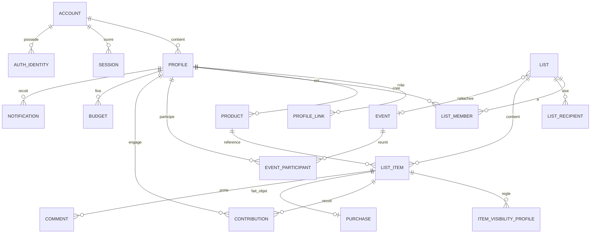

# 12 — Modèle de données

## Objectif

Décrire les entités, leurs relations et les contraintes garanties par la base. Le schéma Prisma en sera la traduction ; ce document reste la référence fonctionnelle.

## Conventions

- Clés primaires : UUID v7 (ordonnés dans le temps, non devinables).
- Toutes les tables : `created_at`, `updated_at` ; `version` (entier) sur les entités modifiables hors ligne ; `deleted_at` pour la corbeille.
- Montants : `amount_minor` (entier 64 bits) + `currency` (ISO 4217, 3 lettres).
- Dates et heures en UTC ; le fuseau du profil sert à l'affichage et aux heures calmes.
- Les énumérations de ce document sont des types énumérés en base.

## Vue d'ensemble

## Identité

| Table | Champs principaux | Contraintes |
|---|---|---|
| `account` | `email`, `email_verified_at`, `password_hash?`, `role` (`USER`/`MODERATOR`/`ADMIN`), `status` (`ACTIVE`/`SUSPENDED`), `totp_secret_enc?`, `totp_enabled_at?`, `age_attested_at`, `auth_epoch` | `email` unique, insensible à la casse ; `age_attested_at` : déclaration « 15 ans ou plus » (AUTH-08) ; `auth_epoch` : génération d'authentification, augmentée par tout événement qui révoque toutes les sessions (ADR 0013, double incrément de l'ADR 0014) |
| `auth_identity` | `account_id`, `provider` (`GOOGLE`), `subject` | (`provider`, `subject`) unique |
| `recovery_code` | `account_id`, `code_hash`, `used_at?` | |
| `account_token` | `account_id`, `purpose` (`EMAIL_VERIFY`/`EMAIL_CHANGE`/`EMAIL_CHANGE_CANCEL`/`PASSWORD_RESET`), `token_hash`, `new_email?`, `expires_at`, `used_at?` | `token_hash` unique (SHA-256, jeton de 256 bits) ; usage unique ; `PASSWORD_RESET` valable 30 minutes (AUTH-06) ; émettre un jeton invalide les jetons non utilisés du même compte et du même usage |
| `session` | `account_id`, `token_hash`, `auth_epoch`, `active_profile_id?`, `reauth_at?`, `trusted_device_id?`, `user_agent`, `last_seen_at`, `expires_at`, `absolute_expires_at` | `token_hash` unique (SHA-256 du jeton) ; `account_id` en `ON DELETE RESTRICT` : une session ne disparaît que par la procédure de révocation ; `auth_epoch` égal à celui du compte, sinon la session est refusée ; `id` seul identifiant exposé par l'API. Le déverrouillage du PIN n'est **pas** en base : il vit dans Redis seulement, et une session relue depuis la base a son profil actif verrouillé (ADR 0013). `last_seen_at` et `expires_at` recopiés depuis Redis au plus toutes les 5 minutes |
| `trusted_device` | `account_id`, `token_hash`, `user_agent`, `created_at`, `expires_at`, `revoked_at?` | `token_hash` unique ; valable 30 jours (AUTH-12), révocable depuis l'espace Compte |
| `profile` | `account_id`, `display_name`, `avatar`, `accent_color`, `birthday_day?`, `birthday_month?`, `birthday_year?`, `locale`, `currency`, `timezone`, `is_child`, `pin_hash?`, `pin_relock` (`NEVER`/`IDLE_15`/`EVERY_OPEN`, défaut `IDLE_15`, PIN-07), `pin_failed_count`, `pin_locked_until?`, `pin_reset_notice_at?` | 10 profils au plus par compte |
| `profile_link` | `profile_a_id`, `profile_b_id`, `status` (`PENDING`/`AWAITING_GUARDIAN`/`ACCEPTED`), `requested_by` | paire unique, `a < b` |
| `profile_block` | `blocker_id`, `blocked_id` | paire unique |
| `invitation` | `kind` (`LINK`/`LIST`/`EVENT`), `target_id`, `token_hash`, `created_by`, `max_uses`, `used_count`, `expires_at`, `revoked_at?` | `token_hash` unique |

## Articles et listes

| Table | Champs principaux | Contraintes |
|---|---|---|
| `product` | `owner_profile_id`, `title`, `description`, `image_key?`, `unit_price_minor?`, `currency`, `merchant?`, `source_url?`, `normalized_url?`, `source` (`LINK`/`PHOTO`/`MANUAL`), `share_level` (`PRIVATE`/`CIRCLE`/`GLOBAL`), `moderation_status`, `extraction_status` (`NONE`/`PENDING`/`DONE`/`FAILED`), `price_checked_at?` | index sur `normalized_url` |
| `list` | `type` (`WISHLIST`/`GIFTLIST`), `title`, `description`, `creator_profile_id`, `event_id?`, `audience` (`MEMBERS`/`CIRCLE`/`EVENT`/`CUSTOM`), `default_item_visibility`, `visibility_edit_role` (`CREATOR`/`OWNER`/`CONTRIBUTOR`), `gift_existence` (`HIDDEN`/`REVEALED`), `gift_content` (`NONE`/`PARTIAL`/`FULL`), `archived_at?` | `gift_content ≠ NONE ⇒ gift_existence = REVEALED` |
| `list_recipient` | `list_id`, `profile_id` | paire unique ; au moins un par liste |
| `list_member` | `list_id`, `profile_id`, `role` (`CREATOR`/`OWNER`/`CONTRIBUTOR`/`READER`) | paire unique ; un seul `CREATOR` ; un destinataire de giftlist ne peut pas être membre |
| `list_audience_profile` | `list_id`, `profile_id` | pour `audience = CUSTOM` |
| `list_item` | `list_id`, `product_id`, `added_by_profile_id`, `intended_recipient_id?`, `quantity`, `unit_price_minor?`, `currency`, `priority`, `note`, `position`, `visibility_mode` (`ALL`/`ONLY`/`EXCEPT`), `status` (`OPEN`/`RESERVED`/`PURCHASED`/`RECEIVED`/`WITHDRAWN`), `is_suggestion`, `shown_to_recipient`, `received_at?`, `carried_from_item_id?`, `version` | `quantity ≥ 1` |
| `item_visibility_profile` | `item_id`, `profile_id` | paire unique |
| `visibility_change_log` | `item_id?`, `list_id?`, `changed_by`, `before`, `after`, `at` | ajout seul |

Le coût total d'un élément n'est pas stocké : `quantity × unit_price_minor`.

## Événements

| Table | Champs principaux | Contraintes |
|---|---|---|
| `event` | `title`, `date`, `type`, `mode` (`EXCHANGE`/`HONOREE`), `is_surprise`, `suggested_budget_minor?`, `currency`, `status` (`UPCOMING`/`DONE`/`CANCELLED`), `created_by` | |
| `event_participant` | `event_id`, `profile_id`, `role` (`ORGANIZER`/`PARTICIPANT`), `is_honoree`, `rsvp` (`PENDING`/`YES`/`MAYBE`/`NO`) | paire unique ; un destinataire d'événement surprise n'a pas de ligne |

## Compta

| Table | Champs principaux | Contraintes |
|---|---|---|
| `contribution` | `item_id`, `profile_id`, `mode` (`FULL`/`PERCENT`/`FIXED`), `percent_bp?` (points de base), `amount_minor`, `settlement` (`NONE`/`DUE`/`CLAIMED`/`SETTLED`), `settled_at?`, `settlement_note?`, `idempotency_key` | (`item_id`, `profile_id`) unique ; somme des montants ≤ coût total, garantie par transaction avec verrou sur l'élément |
| `purchase` | `item_id`, `buyer_profile_id`, `purchased_at?`, `actual_total_minor?`, `receipt_key?` | un par élément |
| `shortfall_notice` | `item_id`, `author_profile_id`, `amount_minor`, `notified_profile_ids`, `at` | reste à couvrir et personnes prévenues (CPT-19) ; lisible par son seul auteur |
| `ledger_entry` | `item_id`, `actor_profile_id`, `kind`, `payload` (avant, après), `idempotency_key`, `at` | ajout seul ; `idempotency_key` unique |
| `budget` | `profile_id`, `event_id?`, `recipient_profile_id?`, `amount_minor`, `currency` | (`profile_id`, `event_id`, `recipient_profile_id`) unique |

## Échanges

| Table | Champs principaux | Contraintes |
|---|---|---|
| `comment` | `item_id`, `thread` (`PUBLIC`/`GIVERS`), `author_profile_id?`, `kind` (`MESSAGE`/`ACTIVITY`), `body`, `image_key?`, `edited_at?`, `deleted_at?` | index (`item_id`, `thread`, `created_at`) |
| `comment_reaction` | `comment_id`, `profile_id`, `emoji` | triple unique |
| `item_follow` | `item_id`, `profile_id` | paire unique |
| `notification` | `profile_id`, `type`, `payload`, `read_at?`, `seq` | `seq` croissant par profil (RT-06) |
| `notification_pref` | `profile_id`, `category`, `channel`, `enabled` | |
| `push_subscription` | `profile_id`, `session_id`, `endpoint`, `keys`, `show_details` | `endpoint` unique |

## Exploitation

| Table | Champs principaux | Contraintes |
|---|---|---|
| `report` | `reporter_profile_id`, `target_kind`, `target_id`, `reason`, `status`, `handled_by?`, `decision?` | |
| `audit_log` | `actor_account_id`, `action`, `target_kind`, `target_id`, `reason`, `ip`, `at` | ajout seul |
| `security_log` | `account_id?`, `event`, `ip`, `user_agent`, `at` | ajout seul |
| `idempotency_record` | `key`, `profile_id`, `request_hash`, `response`, `expires_at` | `key` unique |
| `extraction_cache` | `normalized_url`, `result`, `expires_at` | `normalized_url` unique |

## Contraintes transversales

- **DAT-01** Les invariants critiques sont garantis **en base** et pas seulement dans le code : unicités ci-dessus, contraintes `CHECK` (quantité, montants positifs, cohérence giftlist), clés étrangères avec comportement de suppression explicite.
- **DAT-02** Les tables en ajout seul (`ledger_entry`, `audit_log`, `security_log`, `visibility_change_log`) n'accordent ni `UPDATE` ni `DELETE` au rôle de base de données de l'application. Les privilèges par défaut de l'environnement accordent ces droits sur toute nouvelle table : **la migration qui crée une table en ajout seul les retire explicitement** au rôle applicatif (`REVOKE UPDATE, DELETE`), et un test d'intégration le vérifie pour chaque table de cette liste. Le rôle applicatif n'a aucun droit d'écriture sur `_prisma_migrations`.
- **DAT-03** Deux rôles de base de données : un pour l'application, un pour les migrations. L'application n'a pas le droit de modifier le schéma.
- **DAT-04** Le fil `GIVERS` et le fil `PUBLIC` sont dans la même table mais ne sont jamais lus par la même requête : le dépôt expose deux méthodes distinctes, et celle du fil des offreurs exige une preuve que le demandeur n'est pas destinataire.
- **DAT-05** Sécurité au niveau des lignes (RLS) de PostgreSQL en **défense supplémentaire** sur `comment`, `contribution`, `purchase` et `list_item` : la session de base porte l'identifiant du profil actif, et une politique interdit à un destinataire la lecture des lignes d'offreurs. Le moteur de visibilité reste la barrière principale.
- **DAT-06** Suppression de profil : anonymisation des lignes référencées par d'autres (`contribution`, `comment`, `ledger_entry`), suppression du reste.
- **DAT-07** Les migrations sont versionnées, rejouables, et toute migration destructive se fait en deux déploiements (ajout, puis retrait).

## Index à prévoir

- `list_item (list_id, position)`, `list_item (status)` partiel sur les éléments ouverts.
- `contribution (profile_id, settlement)` pour la vue Comptes.
- `event_participant (profile_id)`, `list_member (profile_id)`, `list_recipient (profile_id)`.
- `notification (profile_id, seq)`.
- Recherche plein texte sur `product (title, description)` avec dictionnaire français, limitée aux champs non soumis à la règle de surprise (VIS-40).

## Questions ouvertes

1. RLS (DAT-05) : coût de mise en œuvre non négligeable avec un ORM. À trancher dans l'ADR 0004 après un essai sur la table `comment`.
2. Stockage des images : disque du serveur ou stockage objet compatible S3. Le second facilite les sauvegardes ; à trancher dans l'ADR 0008.
